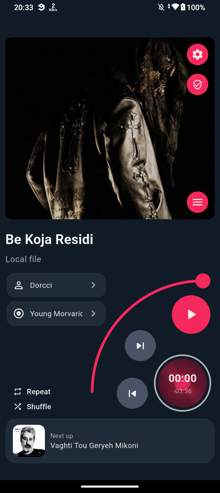
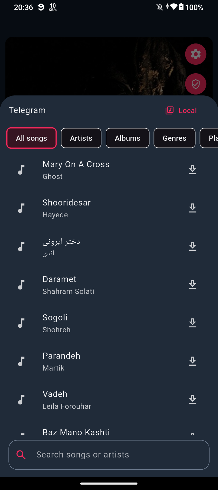
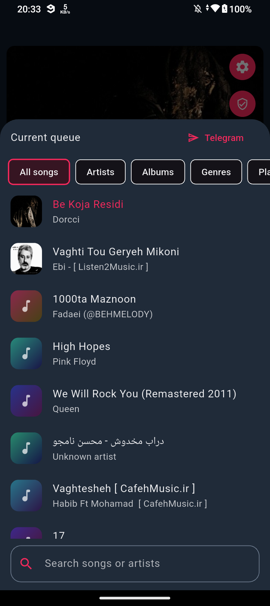
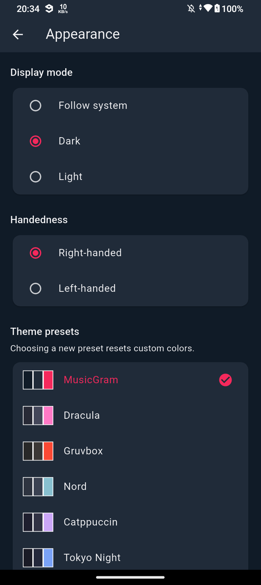
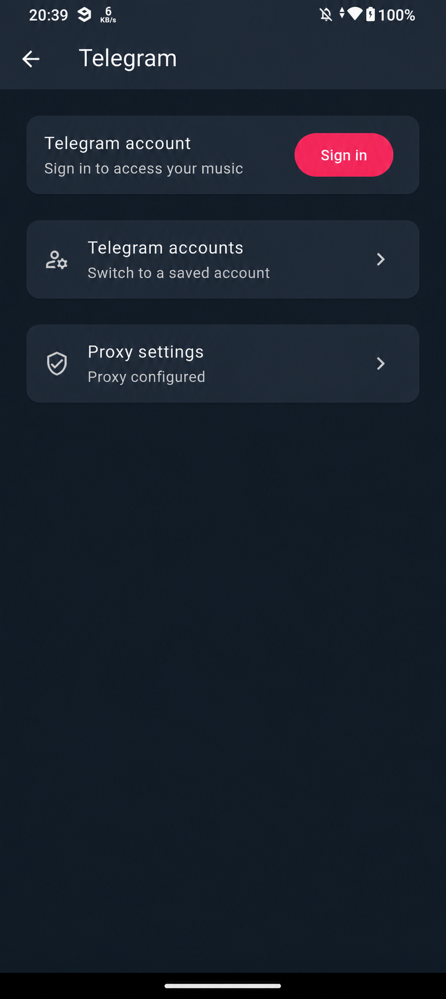

<div align="center">
  
  <h1>MusicGram</h1>
  <p><strong>Your Telegram music, designed for one hand.</strong></p>
  <p>Stream and organize music from Telegram and your device in a player built to feel at home in either hand.</p>
  <p>
    
    
    
  </p>
  <p>
    <a href="#screenshots">Screenshots</a> ·
    <a href="#features">Features</a> ·
    <a href="#getting-started">Getting started</a> ·
    <a href="#building-and-installing">Build &amp; install</a>
  </p>
</div>

---

## Screenshots

<table>
  <tr>
    <td align="center"><strong>One-handed player</strong></td>
    <td align="center"><strong>Telegram music</strong></td>
  </tr>
  <tr>
    <td align="center"></td>
    <td align="center"></td>
  </tr>
  <tr>
    <td align="center"><strong>Your local library</strong></td>
    <td align="center"><strong>Make it yours</strong></td>
  </tr>
  <tr>
    <td align="center"></td>
    <td align="center"></td>
  </tr>
  <tr>
    <td align="center"><strong>Telegram settings</strong> (proxy address redacted)</td>
    <td></td>
  </tr>
  <tr>
    <td align="center"></td>
    <td></td>
  </tr>
</table>

## Features

✋ **Built for one hand** — Playback controls are arranged around your thumb. Choose right- or left-handed mode to put the player on the side that feels natural.

✈️ **A player for your Telegram music** — Select the chats you want to sync, browse their music in a dedicated library, and stream tracks without leaving the player. Download favorites for offline listening and switch to your local library from the queue.

📚 **A library that feels like yours** — Browse songs by artist, album, and genre; build local and Telegram playlists; search your library; and customize playlist covers.

🎨 **Your player, your colors** — Choose light or dark mode, follow your system, pick a theme preset, or customize colors.

🎤 **Lyrics when you want them** — Search [LRCLIB](https://lrclib.net/) automatically or manually, choose a result, and view synchronized lyrics. Selected lyrics are cached for later.

📡 **Ready for the road and the living room** — Browse music with Android Auto or send a song to a compatible UPnP/DLNA renderer on your network. Device and format support can vary.

🛠️ **Control your Telegram connection** — Manage multiple accounts and proxies, view connection logs, and choose which chats to sync. Manage temporary Telegram audio cache separately from your saved downloads.

## Getting started

### Requirements

- Flutter **3.47** with a compatible Dart SDK (the project currently uses Dart 3.13).
- The Android SDK and a connected Android device or emulator for Android builds. Android is the primary supported platform; desktop project files are included, but Android-specific features are not available everywhere.
- A Telegram API ID and API hash for Telegram features. Obtain them from [Telegram's application management page](https://my.telegram.org/).

The repository includes TDLib native libraries for **arm64-v8a** and **x86_64** Android devices. The API ID and hash are supplied at build time; do not commit credentials to the repository. Build-time values are embedded in the resulting app, so they should not be treated as secrets in a distributed APK.

### Set up the project

```bash
git clone https://github.com/mrbooshehri/red-flutter.git
cd red-flutter
flutter pub get
flutter analyze
flutter test
```

## Building and installing

The build script prompts for your Telegram API credentials without echoing the hash:

```bash
./scripts/build_android.sh
```

The APK is written to `build/app/outputs/flutter-apk/app-release.apk`. To build smaller APKs for each supported architecture:

```bash
./scripts/build_android.sh --split
```

To build and install on a connected device, first find its serial with `adb devices`, then run:

```bash
./scripts/build_android.sh --split --install DEVICE_SERIAL
```

The script uses `adb install -r` to update an existing installation. Android retains its data when the package ID and signing key match. The current release configuration uses the **debug signing key**; configure a release signing key before distributing production builds.

## Using Telegram music

1. Open **Settings → Telegram** and sign in to your account. Configure a proxy there if your connection needs one.
2. Open **Sync Telegram music**, select the chats you want, and start syncing.
3. Open the current queue from the player and switch to **Telegram** to browse your synced music.
4. Download tracks you want to keep offline. Manage temporary audio cache under **Settings → Downloads & cache**.

Playlist indexes are cached between visits. Download jobs run while the app is open; a network connection is needed to stream tracks that are not available locally.

## Project layout

```text
lib/                     Flutter player, screens, and services
android/                 Android integration and TDLib libraries
scripts/build_android.sh Android build and update installer
test/                    Flutter unit and widget tests
assets/screenshots/        Screenshots captured from the app
```
